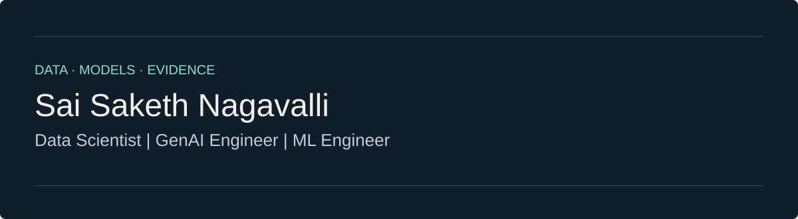

[Portfolio](https://saisakethnagavalli.vercel.app/) · [LinkedIn](https://www.linkedin.com/in/sai-saketh-nagavalli/) · [Resume](https://saisakethnagavalli.vercel.app/resume/Sai_Saketh_Nagavalli_Resume.pdf) · [Email](mailto:saisakethnagavalli@gmail.com)

I build AI and data systems whose behavior can be inspected: where the data came from, how a model was evaluated, and what an answer is grounded in. My independent work spans document retrieval, lakehouse pipelines, applied ML research and useful applications.

### Selected engineering projects

**[UrbanLake](https://github.com/SaiSakethN/urbanlake)** — Make NYC service-request history reproducible, queryable and useful for demand forecasting.

Hosted analytics · local pipeline. Kafka · Spark / Delta · MLflow · FastAPI. [Live demo](https://urbanlake-three.vercel.app) · [Design and evidence](https://github.com/SaiSakethN/urbanlake/blob/main/docs/FULL_DATA_RUN.md)

**[KnowDoc AI](https://github.com/SaiSakethN/knowdoc-ai)** — Ask questions of private documents and inspect the exact source passage, version and page.

Hosted constrained demo · local RAG. FastAPI · PostgreSQL / pgvector · Ollama · React. [Live demo](https://knowdoc-ai.vercel.app) · [Design and evidence](https://github.com/SaiSakethN/knowdoc-ai/blob/main/docs/evaluation-report.md)

**[CareFlow AI](https://github.com/SaiSakethN/careflow-ai)** — Investigate hospital admission outcomes with reproducible features and hospital-grouped evaluation.

Local research prototype. XGBoost · SHAP · Scikit-learn · FastAPI. [Design and evidence](https://github.com/SaiSakethN/careflow-ai/blob/main/docs/target-definition.md)

**[CollabDocs](https://github.com/SaiSakethN/collabdocs)** — Draft, import and share rich-text documents with persistence and explicit conflict handling.

Hosted assessment demo. Next.js · TypeScript · Supabase · Tiptap. [Live demo](https://collabdocs-ten-iota.vercel.app) · [Design and evidence](https://github.com/SaiSakethN/collabdocs/blob/main/ARCHITECTURE.md)

**[Diamonds analytics](https://github.com/SaiSakethN/Diamonds-PowerBI-Dashboard)** — Explore how carat, cut and color relate to diamond pricing through an interactive Power BI report.

Downloadable BI report. Power BI · DAX · Data visualization. [Design and evidence](https://github.com/SaiSakethN/Diamonds-PowerBI-Dashboard/blob/main/README.md)

### How I work

- **Generative AI:** RAG, embeddings, vector search, reranking, citation tracing and LLM evaluation. KnowDoc's hosted demo uses keyword search and supported-profile extraction; hybrid retrieval and generation run locally.
- **Machine learning:** Python, Scikit-learn, XGBoost, TensorFlow, feature engineering and model evaluation. CareFlow is retrospective research, not a clinically validated system.
- **Data engineering:** SQL, PySpark, Kafka, Spark and Delta medallion processing. UrbanLake's documented 23M+ snapshot is historical; source polling is not CDC.
- **MLOps and cloud:** MLflow, Docker, AWS, model serving and monitoring.
- **Backend and applications:** FastAPI, React, TypeScript, PostgreSQL and Supabase.
- **Statistics and experimentation:** A/B testing, hypothesis testing, causal inference, segmentation and time-series forecasting.

### Professional experience

**Included Health — Data Scientist, Gen AI** · January 2026–Present  
RAG member navigation, retrieval quality, LLM evaluation and provider recommendations. My resume reports grounded-answer accuracy improving from 84% to 93% and an evaluation harness with 1,500+ scenarios.

**Neon IT Systems — Data Scientist** · February 2022–July 2024  
Predictive modeling, NLP and product experimentation with Python, SQL, PySpark and AWS. My resume reports work across 10M+ product records and 500K+ text records.

Professional work is separate from the independent repositories above. Employer code, private datasets and internal architecture are not published here.

### Education

**MS in Data Science and Analytics** · Florida Atlantic University · May 2026

Based in **Delray Beach, Florida**. Connect about Data Science, GenAI, ML Engineering and data systems at [saisakethnagavalli@gmail.com](mailto:saisakethnagavalli@gmail.com).

Project scope reviewed November 23, 2026. Historical repository results are distinguished from independently rerun validation.
